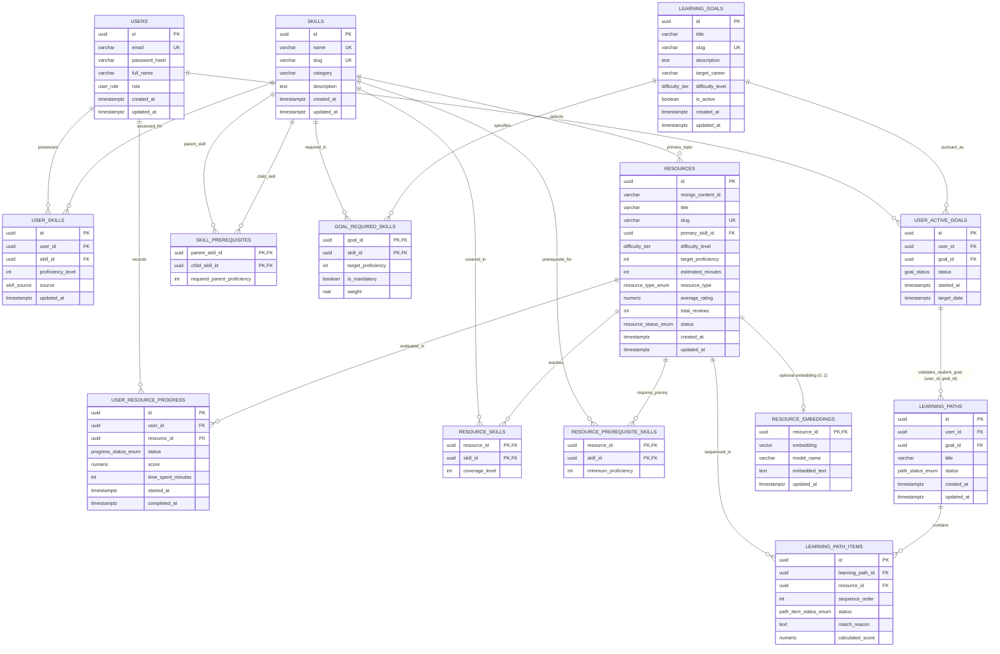

# Relational (PostgreSQL) and Document (MongoDB) Database Specification

## 1. Relational ER Diagram (Crow's Foot Notation with All Attributes)

Every entity includes all attributes, data types, and constraint markings (PK, FK, UK). Cardinalities strictly reflect the 14-table schema (13 core relational tables + 1 optional vector table):
- `RESOURCE_EMBEDDINGS` is **optional (zero or one `0..1`)** for `RESOURCES` and requires the optional `vector` extension.
- `LEARNING_PATHS ||--o{ LEARNING_PATH_ITEMS` correctly reflects zero-to-many cardinality.
- `LEARNING_PATHS` references `USER_ACTIVE_GOALS` via composite foreign key `(user_id, goal_id)`.
- `SKILL_PREREQUISITES` explicitly shows both `parent_skill` and `child_skill` relationships to `SKILLS`.
- `learning_path_items.status` is strictly `LOCKED` or `AVAILABLE` (progress completion is exclusively tracked in `USER_RESOURCE_PROGRESS`).



---

## 2. Complete Conceptual ER Diagram (Chen Notation)

All 14 entities and all attributes are modeled in Chen notation across two connected domains.

### Section 2A: Competency & Goal Domain (Entities 1 to 7)

```mermaid
flowchart TD
    %% Entities
    E1["USERS"]
    E2["SKILLS"]
    E3["SKILL_PREREQUISITES"]
    E4["USER_SKILLS"]
    E5["LEARNING_GOALS"]
    E6["GOAL_REQUIRED_SKILLS"]
    E7["USER_ACTIVE_GOALS"]

    %% USERS Attributes
    A_U_id(["<u>id</u>"]) --- E1
    A_U_email(["email"]) --- E1
    A_U_pwd(["password_hash"]) --- E1
    A_U_name(["full_name"]) --- E1
    A_U_role(["role"]) --- E1
    A_U_ca(["created_at"]) --- E1
    A_U_ua(["updated_at"]) --- E1

    %% SKILLS Attributes
    A_S_id(["<u>id</u>"]) --- E2
    A_S_name(["name"]) --- E2
    A_S_slug(["slug"]) --- E2
    A_S_cat(["category"]) --- E2
    A_S_desc(["description"]) --- E2
    A_S_ca(["created_at"]) --- E2
    A_S_ua(["updated_at"]) --- E2

    %% SKILL_PREREQUISITES Attributes
    A_SP_p(["<u>parent_skill_id</u>"]) --- E3
    A_SP_c(["<u>child_skill_id</u>"]) --- E3
    A_SP_prof(["required_parent_proficiency"]) --- E3

    %% USER_SKILLS Attributes
    A_US_id(["<u>id</u>"]) --- E4
    A_US_uid(["user_id"]) --- E4
    A_US_sid(["skill_id"]) --- E4
    A_US_lvl(["proficiency_level"]) --- E4
    A_US_src(["source"]) --- E4
    A_US_ua(["updated_at"]) --- E4

    %% LEARNING_GOALS Attributes
    A_G_id(["<u>id</u>"]) --- E5
    A_G_title(["title"]) --- E5
    A_G_slug(["slug"]) --- E5
    A_G_desc(["description"]) --- E5
    A_G_car(["target_career"]) --- E5
    A_G_diff(["difficulty_level"]) --- E5
    A_G_act(["is_active"]) --- E5
    A_G_ca(["created_at"]) --- E5
    A_G_ua(["updated_at"]) --- E5

    %% GOAL_REQUIRED_SKILLS Attributes
    A_GR_gid(["<u>goal_id</u>"]) --- E6
    A_GR_sid(["<u>skill_id</u>"]) --- E6
    A_GR_tgt(["target_proficiency"]) --- E6
    A_GR_man(["is_mandatory"]) --- E6
    A_GR_wt(["weight"]) --- E6

    %% USER_ACTIVE_GOALS Attributes
    A_UG_id(["<u>id</u>"]) --- E7
    A_UG_uid(["user_id"]) --- E7
    A_UG_gid(["goal_id"]) --- E7
    A_UG_st(["status"]) --- E7
    A_UG_sa(["started_at"]) --- E7
    A_UG_td(["target_date"]) --- E7

    %% Relationships
    R_US{"assesses"}
    R_UG{"selects"}
    R_GR{"demands"}
    R_SP_P{"has_parent"}
    R_SP_C{"has_child"}

    %% Connections & Cardinalities
    E1 ---|"1"| R_US ---|"N"| E4
    E2 ---|"1"| R_US
    E1 ---|"1"| R_UG ---|"N"| E7
    E5 ---|"1"| R_UG
    E5 ---|"1"| R_GR ---|"N"| E6
    E2 ---|"1"| R_GR
    E2 ---|"1"| R_SP_P ---|"N"| E3
    E2 ---|"1"| R_SP_C ---|"N"| E3
```



---

### Section 2B: Resource, Path & Progress Domain (Entities 7 to 14)

```mermaid
flowchart TD
    %% Anchor Entities from Section 2A
    E1["USERS"]
    E2["SKILLS"]
    E7["USER_ACTIVE_GOALS"]

    %% Section 2B Entities
    E8["RESOURCES"]
    E9["RESOURCE_SKILLS"]
    E10["RESOURCE_PREREQUISITE_SKILLS"]
    E11["RESOURCE_EMBEDDINGS"]
    E12["LEARNING_PATHS"]
    E13["LEARNING_PATH_ITEMS"]
    E14["USER_RESOURCE_PROGRESS"]

    %% RESOURCES Attributes
    A_R_id(["<u>id</u>"]) --- E8
    A_R_mid(["mongo_content_id"]) --- E8
    A_R_tit(["title"]) --- E8
    A_R_slug(["slug"]) --- E8
    A_R_psid(["primary_skill_id"]) --- E8
    A_R_diff(["difficulty_level"]) --- E8
    A_R_tprof(["target_proficiency"]) --- E8
    A_R_mins(["estimated_minutes"]) --- E8
    A_R_type(["resource_type"]) --- E8
    A_R_avg(["average_rating"]) --- E8
    A_R_rev(["total_reviews"]) --- E8
    A_R_st(["status"]) --- E8
    A_R_ca(["created_at"]) --- E8
    A_R_ua(["updated_at"]) --- E8

    %% RESOURCE_SKILLS Attributes
    A_RS_rid(["<u>resource_id</u>"]) --- E9
    A_RS_sid(["<u>skill_id</u>"]) --- E9
    A_RS_cov(["coverage_level"]) --- E9

    %% RESOURCE_PREREQUISITE_SKILLS Attributes
    A_RP_rid(["<u>resource_id</u>"]) --- E10
    A_RP_sid(["<u>skill_id</u>"]) --- E10
    A_RP_min(["minimum_proficiency"]) --- E10

    %% RESOURCE_EMBEDDINGS Attributes
    A_RE_rid(["<u>resource_id</u>"]) --- E11
    A_RE_vec(["embedding [1536]"]) --- E11
    A_RE_mod(["model_name"]) --- E11
    A_RE_txt(["embedded_text"]) --- E11
    A_RE_ua(["updated_at"]) --- E11

    %% LEARNING_PATHS Attributes
    A_LP_id(["<u>id</u>"]) --- E12
    A_LP_uid(["user_id"]) --- E12
    A_LP_gid(["goal_id"]) --- E12
    A_LP_tit(["title"]) --- E12
    A_LP_st(["status"]) --- E12
    A_LP_ca(["created_at"]) --- E12
    A_LP_ua(["updated_at"]) --- E12

    %% LEARNING_PATH_ITEMS Attributes
    A_LPI_id(["<u>id</u>"]) --- E13
    A_LPI_lpid(["learning_path_id"]) --- E13
    A_LPI_rid(["resource_id"]) --- E13
    A_LPI_seq(["sequence_order"]) --- E13
    A_LPI_st(["status (LOCKED/AVAILABLE)"]) --- E13
    A_LPI_rsn(["match_reason"]) --- E13
    A_LPI_scr(["calculated_score"]) --- E13

    %% USER_RESOURCE_PROGRESS Attributes
    A_URP_id(["<u>id</u>"]) --- E14
    A_URP_uid(["user_id"]) --- E14
    A_URP_rid(["resource_id"]) --- E14
    A_URP_st(["status (NOT_STARTED/IN_PROGRESS/COMPLETED)"]) --- E14
    A_URP_scr(["score"]) --- E14
    A_URP_t(["time_spent_minutes"]) --- E14
    A_URP_sa(["started_at"]) --- E14
    A_URP_ca(["completed_at"]) --- E14

    %% Relationships
    R_R_Primary{"primary_topic"}
    R_RS{"teaches_skill"}
    R_RP{"requires_prereq"}
    R_RE{"indexed_by"}
    R_LP_UG{"generated_from"}
    R_LPI{"sequences"}
    R_URP_U{"records_user"}
    R_URP_R{"evaluates_res"}

    %% Connections & Cardinalities
    E8 ---|"N"| R_R_Primary ---|"1"| E2
    E8 ---|"1"| R_RS ---|"N"| E9
    E2 ---|"1"| R_RS
    E8 ---|"1"| R_RP ---|"N"| E10
    E2 ---|"1"| R_RP
    E8 ---|"1"| R_RE ---|"0..1"| E11
    E7 ---|"1"| R_LP_UG ---|"N"| E12
    E12 ---|"1"| R_LPI ---|"N"| E13
    E8 ---|"1"| R_LPI
    E1 ---|"1"| R_URP_U ---|"N"| E14
    E8 ---|"1"| R_URP_R ---|"N"| E14
```



---

## 3. Relational Schema DDL (13 Core Tables)

The core relational schema contains 13 required tables enforcing full referential integrity and ACID guarantees. All core functionality (users, goals, skills, resources, paths, progress, triggers, views, stored functions) executes cleanly on standard PostgreSQL without requiring external extensions.

```sql
-- Extensions
CREATE EXTENSION IF NOT EXISTS "uuid-ossp";

-- Enums
CREATE TYPE user_role AS ENUM ('STUDENT', 'ADMIN');
CREATE TYPE skill_source AS ENUM ('SELF_ASSESSED', 'ASSESSMENT');
CREATE TYPE difficulty_tier AS ENUM ('BEGINNER', 'INTERMEDIATE', 'ADVANCED');
CREATE TYPE goal_status AS ENUM ('IN_PROGRESS', 'COMPLETED', 'ABANDONED');
CREATE TYPE resource_type_enum AS ENUM ('COURSE', 'ARTICLE', 'VIDEO', 'DOCUMENTATION', 'PROJECT');
CREATE TYPE resource_status_enum AS ENUM ('PUBLISHED', 'DRAFT', 'ARCHIVED');
CREATE TYPE path_status_enum AS ENUM ('ACTIVE', 'COMPLETED', 'ARCHIVED');
CREATE TYPE path_item_status_enum AS ENUM ('LOCKED', 'AVAILABLE'); -- Unlocking workflow state
CREATE TYPE progress_status_enum AS ENUM ('NOT_STARTED', 'IN_PROGRESS', 'COMPLETED'); -- Authoritative progress

-- 1. USERS
CREATE TABLE users (
    id UUID PRIMARY KEY DEFAULT uuid_generate_v4(),
    email VARCHAR(255) NOT NULL UNIQUE,
    password_hash VARCHAR(255) NOT NULL,
    full_name VARCHAR(150) NOT NULL,
    role user_role NOT NULL DEFAULT 'STUDENT',
    created_at TIMESTAMPTZ NOT NULL DEFAULT CURRENT_TIMESTAMP,
    updated_at TIMESTAMPTZ NOT NULL DEFAULT CURRENT_TIMESTAMP
);

-- 2. SKILLS
CREATE TABLE skills (
    id UUID PRIMARY KEY DEFAULT uuid_generate_v4(),
    name VARCHAR(100) NOT NULL UNIQUE,
    slug VARCHAR(120) NOT NULL UNIQUE,
    category VARCHAR(80) NOT NULL,
    description TEXT,
    created_at TIMESTAMPTZ NOT NULL DEFAULT CURRENT_TIMESTAMP,
    updated_at TIMESTAMPTZ NOT NULL DEFAULT CURRENT_TIMESTAMP
);

-- 3. SKILL PREREQUISITES (Self-referential DAG)
CREATE TABLE skill_prerequisites (
    parent_skill_id UUID NOT NULL REFERENCES skills(id) ON DELETE CASCADE,
    child_skill_id UUID NOT NULL REFERENCES skills(id) ON DELETE CASCADE,
    required_parent_proficiency INT NOT NULL CHECK (required_parent_proficiency BETWEEN 1 AND 5),
    PRIMARY KEY (parent_skill_id, child_skill_id),
    CONSTRAINT chk_no_self_prerequisite CHECK (parent_skill_id != child_skill_id)
);

-- 4. USER SKILLS
CREATE TABLE user_skills (
    id UUID PRIMARY KEY DEFAULT uuid_generate_v4(),
    user_id UUID NOT NULL REFERENCES users(id) ON DELETE CASCADE,
    skill_id UUID NOT NULL REFERENCES skills(id) ON DELETE CASCADE,
    proficiency_level INT NOT NULL CHECK (proficiency_level BETWEEN 1 AND 5),
    source skill_source NOT NULL DEFAULT 'SELF_ASSESSED',
    updated_at TIMESTAMPTZ NOT NULL DEFAULT CURRENT_TIMESTAMP,
    CONSTRAINT uq_user_skill UNIQUE (user_id, skill_id)
);

-- 5. LEARNING GOALS
CREATE TABLE learning_goals (
    id UUID PRIMARY KEY DEFAULT uuid_generate_v4(),
    title VARCHAR(200) NOT NULL,
    slug VARCHAR(220) NOT NULL UNIQUE,
    description TEXT NOT NULL,
    target_career VARCHAR(120),
    difficulty_level difficulty_tier NOT NULL DEFAULT 'BEGINNER',
    is_active BOOLEAN NOT NULL DEFAULT TRUE,
    created_at TIMESTAMPTZ NOT NULL DEFAULT CURRENT_TIMESTAMP,
    updated_at TIMESTAMPTZ NOT NULL DEFAULT CURRENT_TIMESTAMP
);

-- 6. GOAL REQUIRED SKILLS
CREATE TABLE goal_required_skills (
    goal_id UUID NOT NULL REFERENCES learning_goals(id) ON DELETE CASCADE,
    skill_id UUID NOT NULL REFERENCES skills(id) ON DELETE CASCADE,
    target_proficiency INT NOT NULL CHECK (target_proficiency BETWEEN 1 AND 5),
    is_mandatory BOOLEAN NOT NULL DEFAULT TRUE,
    weight REAL NOT NULL DEFAULT 1.0 CHECK (weight > 0),
    PRIMARY KEY (goal_id, skill_id)
);

-- 7. USER ACTIVE GOALS
CREATE TABLE user_active_goals (
    id UUID PRIMARY KEY DEFAULT uuid_generate_v4(),
    user_id UUID NOT NULL REFERENCES users(id) ON DELETE CASCADE,
    goal_id UUID NOT NULL REFERENCES learning_goals(id) ON DELETE RESTRICT,
    status goal_status NOT NULL DEFAULT 'IN_PROGRESS',
    started_at TIMESTAMPTZ NOT NULL DEFAULT CURRENT_TIMESTAMP,
    target_date TIMESTAMPTZ,
    CONSTRAINT uq_user_active_goal UNIQUE (user_id, goal_id)
);

-- 8. RESOURCES
CREATE TABLE resources (
    id UUID PRIMARY KEY DEFAULT uuid_generate_v4(),
    mongo_content_id VARCHAR(24),
    title VARCHAR(255) NOT NULL,
    slug VARCHAR(280) NOT NULL UNIQUE,
    primary_skill_id UUID NOT NULL REFERENCES skills(id) ON DELETE RESTRICT,
    difficulty_level difficulty_tier NOT NULL DEFAULT 'BEGINNER',
    target_proficiency INT NOT NULL CHECK (target_proficiency BETWEEN 1 AND 5),
    estimated_minutes INT NOT NULL CHECK (estimated_minutes > 0),
    resource_type resource_type_enum NOT NULL DEFAULT 'COURSE',
    average_rating NUMERIC(3, 2) NOT NULL DEFAULT 0.00 CHECK (average_rating BETWEEN 0.00 AND 5.00),
    total_reviews INT NOT NULL DEFAULT 0 CHECK (total_reviews >= 0),
    status resource_status_enum NOT NULL DEFAULT 'PUBLISHED',
    created_at TIMESTAMPTZ NOT NULL DEFAULT CURRENT_TIMESTAMP,
    updated_at TIMESTAMPTZ NOT NULL DEFAULT CURRENT_TIMESTAMP
);

-- 9. RESOURCE SKILLS (All skills covered by resource)
CREATE TABLE resource_skills (
    resource_id UUID NOT NULL REFERENCES resources(id) ON DELETE CASCADE,
    skill_id UUID NOT NULL REFERENCES skills(id) ON DELETE CASCADE,
    coverage_level INT NOT NULL CHECK (coverage_level BETWEEN 1 AND 5),
    PRIMARY KEY (resource_id, skill_id)
);

-- 10. RESOURCE PREREQUISITE SKILLS (Required before taking resource)
CREATE TABLE resource_prerequisite_skills (
    resource_id UUID NOT NULL REFERENCES resources(id) ON DELETE CASCADE,
    skill_id UUID NOT NULL REFERENCES skills(id) ON DELETE RESTRICT,
    minimum_proficiency INT NOT NULL CHECK (minimum_proficiency BETWEEN 1 AND 5),
    PRIMARY KEY (resource_id, skill_id)
);

-- 11. LEARNING PATHS (Composite FK enforces user-goal consistency)
CREATE TABLE learning_paths (
    id UUID PRIMARY KEY DEFAULT uuid_generate_v4(),
    user_id UUID NOT NULL,
    goal_id UUID NOT NULL,
    title VARCHAR(255) NOT NULL,
    status path_status_enum NOT NULL DEFAULT 'ACTIVE',
    created_at TIMESTAMPTZ NOT NULL DEFAULT CURRENT_TIMESTAMP,
    updated_at TIMESTAMPTZ NOT NULL DEFAULT CURRENT_TIMESTAMP,
    CONSTRAINT fk_learning_paths_user_goal 
        FOREIGN KEY (user_id, goal_id) 
        REFERENCES user_active_goals(user_id, goal_id) 
        ON DELETE CASCADE
);

-- 12. LEARNING PATH ITEMS (Sequencing & unlocking workflow only)
CREATE TABLE learning_path_items (
    id UUID PRIMARY KEY DEFAULT uuid_generate_v4(),
    learning_path_id UUID NOT NULL REFERENCES learning_paths(id) ON DELETE CASCADE,
    resource_id UUID NOT NULL REFERENCES resources(id) ON DELETE RESTRICT,
    sequence_order INT NOT NULL CHECK (sequence_order > 0),
    status path_item_status_enum NOT NULL DEFAULT 'LOCKED',
    match_reason TEXT NOT NULL,
    calculated_score NUMERIC(5, 4) NOT NULL CHECK (calculated_score >= 0),
    CONSTRAINT uq_path_sequence UNIQUE (learning_path_id, sequence_order),
    CONSTRAINT uq_path_resource UNIQUE (learning_path_id, resource_id)
);

-- 13. USER RESOURCE PROGRESS (Authoritative source of completion & score)
CREATE TABLE user_resource_progress (
    id UUID PRIMARY KEY DEFAULT uuid_generate_v4(),
    user_id UUID NOT NULL REFERENCES users(id) ON DELETE CASCADE,
    resource_id UUID NOT NULL REFERENCES resources(id) ON DELETE RESTRICT,
    status progress_status_enum NOT NULL DEFAULT 'NOT_STARTED',
    score NUMERIC(5, 2) CHECK (score BETWEEN 0.00 AND 100.00),
    time_spent_minutes INT NOT NULL DEFAULT 0 CHECK (time_spent_minutes >= 0),
    started_at TIMESTAMPTZ DEFAULT CURRENT_TIMESTAMP,
    completed_at TIMESTAMPTZ,
    CONSTRAINT uq_user_resource_progress UNIQUE (user_id, resource_id)
);
```

---

### Optional pgvector Extension & Embedding Table DDL

The 13 core relational tables above form a complete, self-contained schema that executes cleanly on standard PostgreSQL 16 without external extensions. Execute this optional block ONLY if pgvector semantic search is enabled:

```sql
-- Optional: Enable pgvector extension
CREATE EXTENSION IF NOT EXISTS "vector";

-- Optional: Vector Embedding Table (0..1 relationship with resources)
CREATE TABLE resource_embeddings (
    resource_id UUID PRIMARY KEY REFERENCES resources(id) ON DELETE CASCADE,
    embedding vector(1536) NOT NULL,   -- default dimension; adjust to 768 for Gemini text-embedding-004
    model_name VARCHAR(64) NOT NULL DEFAULT 'text-embedding-3-small',
    embedded_text TEXT NOT NULL,
    updated_at TIMESTAMPTZ NOT NULL DEFAULT CURRENT_TIMESTAMP
);
```

---

## 4. Advanced Database Features

### A. Cycle Prevention Trigger for Skill Prerequisites
```sql
CREATE OR REPLACE FUNCTION fn_check_skill_prerequisite_cycle()
RETURNS TRIGGER AS $$
DECLARE
    v_cycle_detected BOOLEAN;
BEGIN
    WITH RECURSIVE skill_chain AS (
        SELECT child_skill_id AS current_skill
        FROM skill_prerequisites
        WHERE parent_skill_id = NEW.child_skill_id

        UNION ALL

        SELECT sp.child_skill_id
        FROM skill_prerequisites sp
        JOIN skill_chain sc ON sp.parent_skill_id = sc.current_skill
    )
    SELECT EXISTS (
        SELECT 1 FROM skill_chain WHERE current_skill = NEW.parent_skill_id
    ) INTO v_cycle_detected;

    IF v_cycle_detected THEN
        RAISE EXCEPTION 'Cyclic prerequisite detected: Skill % cannot depend on Skill % because it creates a circular dependency',
            NEW.child_skill_id, NEW.parent_skill_id;
    END IF;

    RETURN NEW;
END;
$$ LANGUAGE plpgsql;

CREATE TRIGGER trg_check_skill_prerequisite_cycle
BEFORE INSERT OR UPDATE ON skill_prerequisites
FOR EACH ROW
EXECUTE FUNCTION fn_check_skill_prerequisite_cycle();
```

### B. Primary Skill Invariant Enforcement Triggers
Guarantees that `primary_skill_id` always exists in `resource_skills`, its `coverage_level` remains synchronized with `target_proficiency`, and it cannot be deleted directly from `resource_skills`:

```sql
-- 1. Sync on Resource creation or update of primary_skill_id / target_proficiency
CREATE OR REPLACE FUNCTION fn_sync_primary_skill_on_resource()
RETURNS TRIGGER AS $$
BEGIN
    INSERT INTO resource_skills (resource_id, skill_id, coverage_level)
    VALUES (NEW.id, NEW.primary_skill_id, NEW.target_proficiency)
    ON CONFLICT (resource_id, skill_id)
    DO UPDATE SET coverage_level = EXCLUDED.coverage_level;

    RETURN NEW;
END;
$$ LANGUAGE plpgsql;

CREATE TRIGGER trg_sync_primary_skill_on_resource
AFTER INSERT OR UPDATE OF primary_skill_id, target_proficiency ON resources
FOR EACH ROW
EXECUTE FUNCTION fn_sync_primary_skill_on_resource();

-- 2. Prevent direct deletion of primary skill from resource_skills
CREATE OR REPLACE FUNCTION fn_prevent_delete_primary_skill()
RETURNS TRIGGER AS $$
BEGIN
    IF EXISTS (
        SELECT 1 FROM resources 
        WHERE id = OLD.resource_id AND primary_skill_id = OLD.skill_id
    ) THEN
        RAISE EXCEPTION 'Integrity violation: Cannot delete primary skill % for resource % from resource_skills. It is the primary skill anchor.',
            OLD.skill_id, OLD.resource_id;
    END IF;
    RETURN OLD;
END;
$$ LANGUAGE plpgsql;

CREATE TRIGGER trg_prevent_delete_primary_skill
BEFORE DELETE ON resource_skills
FOR EACH ROW
EXECUTE FUNCTION fn_prevent_delete_primary_skill();

-- 3. Prevent direct coverage_level desynchronization for the primary skill
CREATE OR REPLACE FUNCTION fn_check_primary_skill_coverage_update()
RETURNS TRIGGER AS $$
DECLARE
    v_target_prof INT;
BEGIN
    SELECT target_proficiency INTO v_target_prof
    FROM resources
    WHERE id = NEW.resource_id AND primary_skill_id = NEW.skill_id;

    IF v_target_prof IS NOT NULL AND NEW.coverage_level != v_target_prof THEN
        RAISE EXCEPTION 'Integrity violation: Coverage level for primary skill % must match target_proficiency (%) of resource %',
            NEW.skill_id, v_target_prof, NEW.resource_id;
    END IF;

    RETURN NEW;
END;
$$ LANGUAGE plpgsql;

CREATE TRIGGER trg_check_primary_skill_coverage_update
BEFORE UPDATE ON resource_skills
FOR EACH ROW
EXECUTE FUNCTION fn_check_primary_skill_coverage_update();
```

### C. View: `v_student_skill_gaps`
```sql
CREATE OR REPLACE VIEW v_student_skill_gaps AS
SELECT 
    uag.user_id,
    uag.goal_id,
    lg.title AS goal_title,
    s.id AS skill_id,
    s.name AS skill_name,
    grs.target_proficiency,
    COALESCE(us.proficiency_level, 0) AS current_proficiency,
    GREATEST(0, grs.target_proficiency - COALESCE(us.proficiency_level, 0)) AS proficiency_gap,
    grs.is_mandatory,
    grs.weight
FROM user_active_goals uag
JOIN learning_goals lg ON lg.id = uag.goal_id
JOIN goal_required_skills grs ON grs.goal_id = lg.id
JOIN skills s ON s.id = grs.skill_id
LEFT JOIN user_skills us ON us.user_id = uag.user_id AND us.skill_id = s.id
WHERE uag.status = 'IN_PROGRESS';
```

### D. View: `v_learning_path_progress`
Calculates progress strictly by joining `learning_path_items` with `user_resource_progress`:

```sql
CREATE OR REPLACE VIEW v_learning_path_progress AS
SELECT 
    lp.id AS learning_path_id,
    lp.user_id,
    lp.goal_id,
    lp.title AS path_title,
    lp.status AS path_status,
    COUNT(lpi.id) AS total_items,
    COUNT(lpi.id) FILTER (WHERE urp.status = 'COMPLETED') AS completed_items,
    COALESCE(SUM(r.estimated_minutes), 0) AS estimated_total_minutes,
    COALESCE(SUM(r.estimated_minutes) FILTER (WHERE urp.status = 'COMPLETED'), 0) AS completed_minutes,
    ROUND(
        CASE 
            WHEN COUNT(lpi.id) = 0 THEN 0.00
            ELSE (COUNT(lpi.id) FILTER (WHERE urp.status = 'COMPLETED')::NUMERIC / COUNT(lpi.id)) * 100.00
        END, 2
    ) AS progress_percentage
FROM learning_paths lp
LEFT JOIN learning_path_items lpi ON lpi.learning_path_id = lp.id
LEFT JOIN resources r ON r.id = lpi.resource_id
LEFT JOIN user_resource_progress urp 
    ON urp.user_id = lp.user_id AND urp.resource_id = lpi.resource_id
GROUP BY lp.id, lp.user_id, lp.goal_id, lp.title, lp.status;
```

### E. Transactional Stored Procedure `fn_complete_resource_in_path`
Enforces sequential completion, non-consecutive order traversal, genuine idempotency without modifying completed records, and transaction-scoped advisory locking to serialize concurrent cross-path completions for the same `(user_id, resource_id)`:

```sql
CREATE OR REPLACE FUNCTION fn_complete_resource_in_path(
    p_user_id UUID,
    p_path_id UUID,
    p_resource_id UUID,
    p_score NUMERIC
) RETURNS JSONB AS $$
DECLARE
    v_path_owner UUID;
    v_item_id UUID;
    v_item_status path_item_status_enum;
    v_current_seq INT;
    v_has_incomplete_prior BOOLEAN := FALSE;
    v_already_completed BOOLEAN := FALSE;
    v_candidate_id UUID;
    v_candidate_seq INT;
    v_candidate_status path_item_status_enum;
    v_candidate_progress progress_status_enum;
    v_unlocked_item_id UUID := NULL;
    v_total_items INT;
    v_completed_items INT;
BEGIN
    -- 1. Lock the learning path row and verify student ownership (serializes same-path concurrency)
    SELECT user_id INTO v_path_owner
    FROM learning_paths
    WHERE id = p_path_id
    FOR UPDATE;

    IF v_path_owner IS NULL THEN
        RAISE EXCEPTION 'Not found: Learning path % does not exist', p_path_id;
    END IF;

    IF v_path_owner != p_user_id THEN
        RAISE EXCEPTION 'Authorization error: Path % does not belong to user %', p_path_id, p_user_id;
    END IF;

    -- 2. Lock and verify the target learning path item
    SELECT id, status, sequence_order 
    INTO v_item_id, v_item_status, v_current_seq
    FROM learning_path_items
    WHERE learning_path_id = p_path_id AND resource_id = p_resource_id
    FOR UPDATE;

    IF v_item_id IS NULL THEN
        RAISE EXCEPTION 'Validation error: Resource % does not belong to path %', p_resource_id, p_path_id;
    END IF;

    -- 3. Verify that NO prior sequential item in this path is incomplete
    -- (A student cannot use a previously completed or locked resource to skip earlier incomplete items)
    SELECT EXISTS (
        SELECT 1 
        FROM learning_path_items prev_lpi
        LEFT JOIN user_resource_progress prev_urp 
            ON prev_urp.user_id = p_user_id 
           AND prev_urp.resource_id = prev_lpi.resource_id 
           AND prev_urp.status = 'COMPLETED'
        WHERE prev_lpi.learning_path_id = p_path_id 
          AND prev_lpi.sequence_order < v_current_seq
          AND prev_urp.id IS NULL
    ) INTO v_has_incomplete_prior;

    IF v_has_incomplete_prior THEN
        RAISE EXCEPTION 'Validation error: Cannot complete resource % because earlier resources in path % are not completed.',
            p_resource_id, p_path_id;
    END IF;

    -- 4. Acquire transaction-scoped PostgreSQL advisory lock keyed on (user_id, resource_id).
    -- Serializes concurrent completion requests for the exact same user and resource across different learning paths.
    -- Automatically released when this transaction commits or rolls back.
    PERFORM pg_advisory_xact_lock(hashtext(p_user_id::text), hashtext(p_resource_id::text));

    -- 5. Check if already completed in authoritative user_resource_progress
    SELECT EXISTS (
        SELECT 1 FROM user_resource_progress
        WHERE user_id = p_user_id AND resource_id = p_resource_id AND status = 'COMPLETED'
    ) INTO v_already_completed;

    -- 6. If this item was still LOCKED in this path, unlock it now that all prior items are verified complete
    IF v_item_status = 'LOCKED' THEN
        UPDATE learning_path_items 
        SET status = 'AVAILABLE' 
        WHERE id = v_item_id;
        v_item_status := 'AVAILABLE';
    END IF;

    -- 7. Record completion in user_resource_progress ONLY if not already completed
    -- (Preserves initial score and completed_at timestamp on repeated requests)
    IF NOT v_already_completed THEN
        INSERT INTO user_resource_progress (user_id, resource_id, status, score, completed_at)
        VALUES (p_user_id, p_resource_id, 'COMPLETED', p_score, CURRENT_TIMESTAMP)
        ON CONFLICT (user_id, resource_id)
        DO UPDATE SET 
            status = 'COMPLETED',
            score = EXCLUDED.score,
            completed_at = CURRENT_TIMESTAMP;
    END IF;

    -- 8. Advance the path: sequentially unlock downstream items as long as prior items are completed
    -- (Uses smallest sequence_order > v_current_seq without assuming consecutive integers)
    LOOP
        SELECT lpi.id, lpi.sequence_order, lpi.status, urp.status
        INTO v_candidate_id, v_candidate_seq, v_candidate_status, v_candidate_progress
        FROM learning_path_items lpi
        LEFT JOIN user_resource_progress urp 
            ON urp.user_id = p_user_id 
           AND urp.resource_id = lpi.resource_id
        WHERE lpi.learning_path_id = p_path_id 
          AND lpi.sequence_order > v_current_seq
        ORDER BY lpi.sequence_order ASC
        LIMIT 1
        FOR UPDATE OF lpi;

        EXIT WHEN v_candidate_id IS NULL; -- End of learning path reached

        -- Unlock candidate if currently LOCKED
        IF v_candidate_status = 'LOCKED' THEN
            UPDATE learning_path_items 
            SET status = 'AVAILABLE' 
            WHERE id = v_candidate_id;
            
            v_unlocked_item_id := v_candidate_id;
        END IF;

        -- If this candidate was ALREADY completed (e.g. from another path), cascade forward!
        IF v_candidate_progress = 'COMPLETED' THEN
            v_current_seq := v_candidate_seq;
        ELSE
            -- Candidate is available but not yet completed: stop cascade here
            EXIT;
        END IF;
    END LOOP;

    -- 9. Check if all items in this path are completed (via user_resource_progress join)
    SELECT 
        COUNT(lpi.id),
        COUNT(lpi.id) FILTER (WHERE urp.status = 'COMPLETED')
    INTO v_total_items, v_completed_items
    FROM learning_path_items lpi
    LEFT JOIN user_resource_progress urp 
        ON urp.user_id = p_user_id AND urp.resource_id = lpi.resource_id
    WHERE lpi.learning_path_id = p_path_id;

    IF v_completed_items >= v_total_items AND v_total_items > 0 THEN
        UPDATE learning_paths
        SET status = 'COMPLETED', updated_at = CURRENT_TIMESTAMP
        WHERE id = p_path_id;
    END IF;

    RETURN jsonb_build_object(
        'success', true,
        'path_id', p_path_id,
        'resource_id', p_resource_id,
        'already_completed', v_already_completed,
        'completed_items', v_completed_items,
        'total_items', v_total_items,
        'path_completed', (v_completed_items >= v_total_items AND v_total_items > 0),
        'unlocked_item_id', v_unlocked_item_id
    );
END;
$$ LANGUAGE plpgsql;
```

---

## 5. MongoDB Content Schema & Optional Reviews

Single collection: `resource_contents`. Reviews are optional sub-documents.

```json
{
  "_id": "65f123456789abcdef012345",
  "postgres_resource_id": "9b1deb4d-3b7d-4bad-9bdd-2b0d7b3dcb6d",
  "summary": "Master the theory and practice of database normalization — from 1NF through BCNF — using realistic schema examples.",
  "full_description_markdown": "# Relational Database Normalization\n\nCovers functional dependencies, anomalies in unnormalized tables, and step-by-step decomposition through 1NF, 2NF, 3NF, and BCNF with worked examples.",
  "modules": [
    {
      "module_number": 1,
      "title": "Functional Dependencies and Anomalies",
      "duration_minutes": 40,
      "topics": ["Partial Dependency", "Transitive Dependency", "Insert/Update/Delete Anomalies"]
    },
    {
      "module_number": 2,
      "title": "Decomposition to 3NF and BCNF",
      "duration_minutes": 50,
      "topics": ["Lossless Decomposition", "Dependency Preservation", "BCNF vs 3NF Trade-offs"]
    }
  ],
  "topics": ["normalization", "functional-dependency", "3NF", "BCNF", "relational-model"],
  "tags": ["dbms-core", "schema-design", "beginner-friendly"],
  "author": {
    "name": "Dr. Ramesh Iyer",
    "affiliation": "Department of Computer Science",
    "avatar_url": "https://university.edu/faculty/riyer.jpg"
  },
  "external_references": [
    { "type": "TEXTBOOK_CHAPTER", "url": "https://db-book.com/chapter10" }
  ],
  "reviews": [
    {
      "user_id": "4a2c10b7-9f6b-4ef1-801a-3c721b069d2a",
      "user_name": "Priya Sharma",
      "rating": 5,
      "comment": "The BCNF decomposition worked examples were exactly what I needed for my DBMS exam.",
      "created_at": "2026-03-12T14:20:00Z"
    }
  ],
  "created_at": "2026-01-10T10:00:00Z",
  "updated_at": "2026-03-15T18:30:00Z"
}
```
