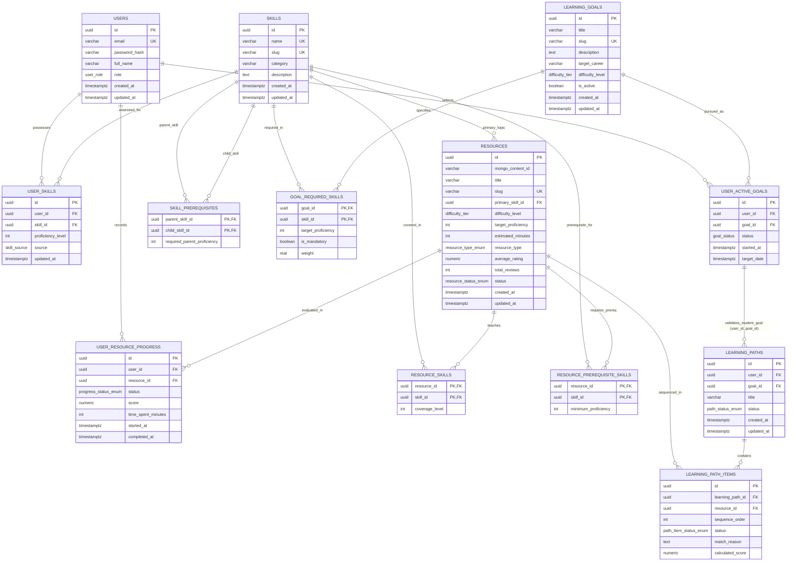

# Pathwise — Implemented Database Schema

The delivered database contains **13 PostgreSQL tables**. `scripts/init-db.sql` is authoritative. No `resource_embeddings` table, vector column, or pgvector extension is implemented.

## Complete relational schema

## Corrected Chen diagram

See [complete Chen diagram](../../Pathwise-ER-Chen-Corrected.svg). Each junction table is modeled consistently as an associative entity. Attribute ovals are separate; primary keys are underlined; unique attributes have UQ markers. Relationship panels use 1:N labels and double lines for total participation. Repeated entity rectangles identify the same entity.

The resources-to-resource_skills relationship additionally has total resource participation because the primary-skill synchronization and protection triggers maintain primary coverage.

## Composite and unique constraints

- learning_paths(user_id, goal_id) references user_active_goals(user_id, goal_id).
- user_skills: UNIQUE(user_id, skill_id).
- user_active_goals: UNIQUE(user_id, goal_id).
- learning_path_items: UNIQUE(learning_path_id, sequence_order), UNIQUE(learning_path_id, resource_id).
- user_resource_progress: UNIQUE(user_id, resource_id).

## ALTER demonstration

The final ZIP includes scripts/alter-demo.sql. When applied, it adds resources.last_reviewed_at TIMESTAMPTZ, sets its future-insert default to CURRENT_TIMESTAMP, and adds chk_completed_has_timestamp to user_resource_progress. These are an optional applied-schema overlay, not part of init-db.sql. Applying the undo script removes them.

## MongoDB linkage

The resource_contents collection stores resource_id (unique PostgreSQL resource UUID), description, objectives, modules with chapters and notes, tags, and editable practice exercises with quiz choices and feedback. PostgreSQL resources.mongo_content_id stores the MongoDB document identifier. There is no cross-database foreign key.
