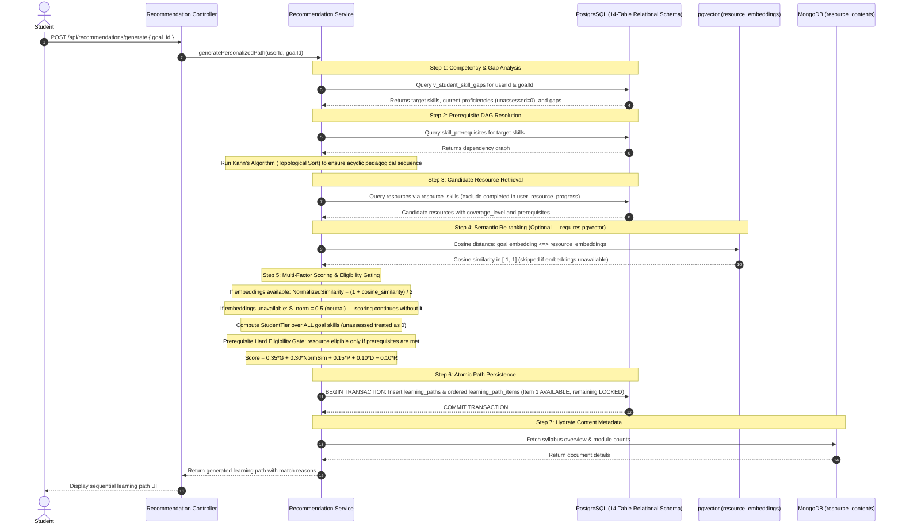

# Recommendation Engine and Semantic Search Specification

## 1. Recommendation Workflow

The recommendation engine creates an individualized, pedagogically sound, and deterministic learning path tailored to a student's prior knowledge and intended goal.



---

## 2. Recommendation Scoring Formula & Normalization

Every candidate resource is evaluated using the following deterministic formula:

$$\text{Score} = 0.35 \times G + 0.30 \times S_{\text{norm}} + 0.15 \times P + 0.10 \times D + 0.10 \times R$$

All 5 factors are strictly normalized in $[0.0, 1.0]$.

### 1. Skill Gap Relevance ($G \in [0, 1]$)
Measures how effectively the resource's covered skills match the student's active gaps:
$$G(r) = \frac{\sum_{s \in \text{CoveredSkills}(r)} \min(\text{coverage\_level}(r, s), \Delta(s))}{\sum_{s \in \text{CoveredSkills}(r)} \max(1, \Delta(s))}$$
Where $\Delta(s) = \max(0, \text{TargetProf}(s) - \text{CurrentProf}(s))$ from `v_student_skill_gaps`.

### 2. Normalized Semantic Similarity ($S_{\text{norm}} \in [0, 1]$)
When pgvector is configured and embeddings are available, cosine similarity maps between $[-1.0, 1.0]$ and is normalized to $[0.0, 1.0]$:
$$S_{\text{norm}} = \frac{1.0 + \text{cosine\_similarity}}{2.0}$$
where cosine similarity is retrieved via the pgvector `<=>` operator.

**When pgvector is unavailable or not configured**:
The recommendation engine operates completely, robustly, and deterministically without embeddings or external API keys. In this mode, $S_{\text{norm}}$ is assigned the constant neutral value:
$$S_{\text{norm}} = 0.50$$
Its contribution to the total score is therefore an invariant constant across all candidate resources:
$$0.30 \times S_{\text{norm}} = 0.30 \times 0.50 = 0.15$$
Because this contribution is identical for every candidate resource, it does not alter candidate rankings. The personalized learning path sequence is driven entirely by the four remaining deterministic factors: skill gap relevance ($G$), prerequisite readiness ($P$), difficulty suitability ($D$), and Bayesian-smoothed rating ($R$).

### 3. Prerequisite Readiness ($P \in [0, 1]$)
Fraction of required prerequisites satisfied by the student's current proficiency:
$$P(r, u) = \begin{cases} 
   1.0, & \text{if } |\text{Prereqs}(r)| = 0 \\ 
   \frac{1}{|\text{Prereqs}(r)|} \sum_{p \in \text{Prereqs}(r)} \min\left(1.0, \frac{\text{CurrentProf}(u, p.s)}{p.\text{min\_prof}}\right), & \text{otherwise} 
\end{cases}$$

> **Hard Eligibility Gating**: Prerequisite compatibility is not only a score factor; it is an **eligibility gate**. A candidate resource cannot be scheduled at position $k$ in the learning path unless all its prerequisites are met by the student's baseline proficiency or by resources scheduled at positions $< k$.

### 4. Difficulty Suitability ($D \in [0, 1]$) & Deterministic `StudentTier`
Aligns resource difficulty tier with the student's baseline competency tier.

**Exact `StudentTier` Computation**:
1. All skills required by the selected goal (from `goal_required_skills`) are evaluated.
2. **Missing student skill assessments in `user_skills` are explicitly treated as proficiency 0**:
   $$\text{CurrentProf}(u, s) = \begin{cases} \text{proficiency\_level}, & \text{if } (u, s) \in \text{user\_skills} \\ 0, & \text{otherwise} \end{cases}$$
3. The average baseline proficiency $\text{AvgProf}(u)$ is calculated across **all** goal skills ($N = |\text{GoalSkills}|$):
   $$\text{AvgProf}(u) = \frac{\sum_{s \in \text{GoalSkills}} \text{CurrentProf}(u, s)}{|\text{GoalSkills}|}$$
4. Mapped deterministically to integer tier:
   $$\text{StudentTier}(u) = \begin{cases} 
      1 \ (\text{Beginner}), & \text{if } \text{AvgProf}(u) < 2.0 \\ 
      2 \ (\text{Intermediate}), & \text{if } 2.0 \le \text{AvgProf}(u) < 3.5 \\ 
      3 \ (\text{Advanced}), & \text{if } \text{AvgProf}(u) \ge 3.5 
   \end{cases}$$
5. Resource difficulty tiers are mapped as: $\text{BEGINNER} \to 1$, $\text{INTERMEDIATE} \to 2$, $\text{ADVANCED} \to 3$.
6. Difficulty suitability factor:
   $$D(r, u) = 1.0 - \frac{|\text{ResourceTier}(r) - \text{StudentTier}(u)|}{2.0}$$
   - Identical tier $\implies 1.0$
   - 1 tier separation $\implies 0.5$
   - 2 tiers separation $\implies 0.0$

### 5. Resource Rating ($R \in [0, 1]$)
Normalized from 5-star scale using Bayesian smoothing (preventing distortion when reviews are few or absent):
$$R(r) = \frac{(\text{average\_rating} \times \text{total\_reviews}) + (3.0 \times 2)}{5.0 \times (\text{total\_reviews} + 2)}$$
When a resource has 0 reviews, $R = \frac{6.0}{10.0} = 0.60$ (neutral baseline).

---

## 3. Search Strategy: PostgreSQL Full-Text Search (Primary) and pgvector (Optional)

The **primary search implementation** uses PostgreSQL built-in full-text search (`tsvector`/`tsquery`), which requires no external API key and works on every PostgreSQL 16 installation.

pgvector semantic search is an **optional enhancement**. It is included in the schema and documented here because it is relevant to the DBMS course's polyglot-database theme, but it is not activated unless an embedding API key is configured in `.env.local`. All core functionality (recommendations, catalog, skill gaps, learning paths) works without it.

### Primary Search: PostgreSQL Full-Text Search

```sql
SELECT
    r.id,
    r.title,
    r.difficulty_level,
    r.estimated_minutes,
    r.average_rating,
    ts_rank(
        to_tsvector('english', r.title || ' ' || COALESCE(r.slug, '')),
        plainto_tsquery('english', $1)
    ) AS relevance_score
FROM resources r
WHERE r.status = 'PUBLISHED'
  AND to_tsvector('english', r.title || ' ' || COALESCE(r.slug, ''))
      @@ plainto_tsquery('english', $1)
ORDER BY relevance_score DESC
LIMIT $2;
```

A `GIN` index on `to_tsvector('english', title || ' ' || slug)` makes this efficient.

### Optional Enhancement: pgvector Semantic Search

When an embedding API is configured and `resource_embeddings` rows are populated, the search endpoint switches to cosine similarity:

- **Model**: Configurable — e.g. OpenAI `text-embedding-3-small` (1536 dims) or Google `text-embedding-004` (768 dims). The `resource_embeddings.model_name` column records which model generated each embedding. The vector column dimension in DDL must match the chosen model.
- **Granularity**: Exactly **one embedding per resource**.
- **Embedded Text Template**:
  ```text
  "${resource.title} | ${resource.description} | Topics: ${topics.join(', ')}"
  ```

### Handling Missing or Unavailable Embeddings

1. **At Ingestion**: When a resource is published and pgvector is configured, its embedding is stored in `resource_embeddings`.
2. **Missing Embedding Fallback**: If `resource_embeddings` has no row for a resource, or if no embedding API is configured, the system falls back to PostgreSQL Full-Text Search (shown above).
3. **Outdated Embeddings**: When an admin updates a resource title or description, `resource_embeddings.updated_at` is flagged for re-embedding.

### Cosine Similarity Query (when pgvector is active):

```sql
SELECT
    r.id,
    r.title,
    r.difficulty_level,
    r.estimated_minutes,
    r.average_rating,
    (1.0 + (1.0 - (re.embedding <=> $1))) / 2.0 AS normalized_similarity_score
FROM resource_embeddings re
JOIN resources r ON r.id = re.resource_id
WHERE r.status = 'PUBLISHED'
  AND ((1.0 + (1.0 - (re.embedding <=> $1))) / 2.0) >= $2
ORDER BY re.embedding <=> $1 ASC
LIMIT $3;
```
