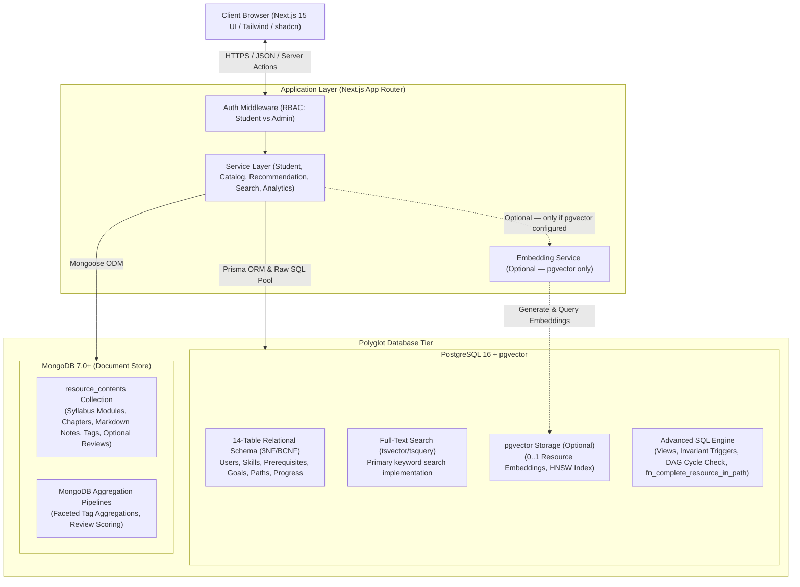

# System Architecture & Polyglot Database Design

## 1. Project Folder Structure

A clean, modular Next.js 15 (App Router) monolithic architecture separating presentation, business services, and polyglot persistence tiers. Every API endpoint documented in the specification maps to a dedicated route handler with non-conflicting dynamic route segments.

```text
DBMS/
├── .env.example
├── .env.local
├── .gitignore
├── README.md
├── package.json
├── tsconfig.json
├── next.config.ts
├── postcss.config.mjs
├── tailwind.config.ts
├── docs/
│   └── architecture/
│       ├── SYSTEM_ARCHITECTURE.md
│       ├── DATABASE_SCHEMA.md
│       ├── RECOMMENDATION_AND_SEARCH.md
│       └── API_SPECIFICATION.md
├── prisma/
│   ├── schema.prisma              # 14-table PostgreSQL schema + pgvector definition
│   ├── migrations/                # Version-controlled SQL migrations
│   └── seed.ts                    # PostgreSQL seed script (users, skills, goals, resources)
├── scripts/
│   ├── init-db.sql                # SQL extensions, triggers, functions, views
│   ├── seed-mongo.ts              # MongoDB educational resource content seeder
│   └── generate-embeddings.ts     # (Optional) pgvector embedding generation — requires external API key
├── src/
│   ├── app/                       # Next.js App Router
│   │   ├── (auth)/                # Route group: Authentication (/login, /register)
│   │   ├── (dashboard)/           # Protected: /dashboard, /profile, /goals, /learning-path, /resources, /admin
│   │   └── api/                   # RESTful API route handlers
│   │       ├── auth/
│   │       │   ├── register/
│   │       │   │   └── route.ts   # POST: User registration with bcrypt hashing
│   │       │   └── [...nextauth]/
│   │       │       └── route.ts   # GET/POST: Auth.js session handler
│   │       ├── student/
│   │       │   ├── profile/
│   │       │   │   └── route.ts   # GET: Student profile and stats
│   │       │   ├── skills/
│   │       │   │   ├── route.ts   # GET: list skills, POST: upsert skill assessment
│   │       │   │   └── [skillId]/
│   │       │   │       └── route.ts # DELETE: remove assessed skill
│   │       │   └── goals/
│   │       │       ├── select/
│   │       │       │   └── route.ts # POST: enroll in learning goal
│   │       │       └── gaps/
│   │       │           └── route.ts # GET: query v_student_skill_gaps
│   │       ├── goals/
│   │       │   ├── route.ts       # GET: catalog of learning goals
│   │       │   └── [id]/
│   │       │       └── route.ts   # GET: specific goal specifications
│   │       ├── resources/
│   │       │   ├── route.ts       # GET: catalog search and filtering
│   │       │   ├── [id]/
│   │       │   │   ├── route.ts   # GET: hydrated resource deep-dive
│   │       │   │   └── review/
│   │       │   │       └── route.ts # POST: optional review to MongoDB & rating sync
│   │       │   └── search/
│   │       │       └── route.ts       # POST: keyword search via PostgreSQL FTS (primary; optional pgvector)
│   │       ├── recommendations/
│   │       │   └── generate/
│   │       │       └── route.ts   # POST: generate personalized learning path
│   │       ├── learning-paths/
│   │       │   ├── active/
│   │       │   │   └── route.ts   # GET: current active learning path & progress
│   │       │   └── [pathId]/
│   │       │       ├── route.ts   # GET: specific path details & sequence
│   │       │       └── resources/
│   │       │           └── [resourceId]/
│   │       │               └── progress/
│   │       │                   └── route.ts # POST: complete resource via stored procedure
│   │       └── admin/
│   │           ├── analytics/
│   │           │   ├── overview/
│   │           │   │   └── route.ts # GET: aggregate KPIs
│   │           │   └── skills/
│   │           │       └── route.ts # GET: skills gap distribution
│   │           └── resources/
│   │               ├── route.ts   # POST: create resource (PG + Mongo)
│   │               └── [id]/
│   │                   └── route.ts # PUT: update, DELETE: archive
│   ├── components/                # Reusable UI components (shadcn/ui, layout, recommendations, search)
│   ├── lib/                       # Database clients & utilities
│   │   ├── db/                    # postgres.ts (Prisma/pg Pool), mongodb.ts (Mongoose), vector.ts (optional)
│   │   ├── models/                # ResourceContent.ts (Single MongoDB collection)
│   │   ├── auth/                  # Auth.js configuration & bcrypt hashing
│   │   └── ai/                    # embeddings.ts (optional — pgvector only; not required for core features)
│   ├── services/                  # Business logic (student, catalog, recommendation, search, analytics)
│   └── types/                     # Shared TypeScript interfaces & DTOs
```

---

## 2. High-Level System Architecture Diagram



---

## 3. Polyglot Persistence Justification: PostgreSQL vs. MongoDB vs. pgvector

| Dimension | PostgreSQL 16 | MongoDB 7.0+ | pgvector Extension |
| :--- | :--- | :--- | :--- |
| **Role** | Relational Backbone & State of Record | Unstructured Educational Content Store | Vector Storage & Semantic Search |
| **Data Stored** | 14 relational tables: Users, Skills, Goals, Prerequisites, Resource metadata, Path Sequencing, Authoritative Progress. | Single collection `resource_contents`: rich syllabi, chapter modules, reading notes, optional reviews. | Dense float vectors co-located with `resources`. Dimension depends on chosen model (768 for Gemini `text-embedding-004`, 1536 for OpenAI `text-embedding-3-small`). |
| **Academic Justification** | - Enforces **ACID** guarantees for student enrollments, paths, and progress.<br>- Guarantees referential integrity through foreign keys.<br>- Rigorous 3NF/BCNF normalization prevents duplicate mappings. | - Accommodates polymorphic and hierarchical educational formats (modules, chapters, checklists).<br>- Avoids complex 5-table JOINs for multi-section course syllabi.<br>- Allows schema flexibility without table migrations. | - Native inside PostgreSQL: avoids network latency to external vector DBs.<br>- **Optional**: The system uses PostgreSQL Full-Text Search (`tsvector`/`tsquery`) as the primary keyword search. pgvector enables optional semantic re-ranking when an embedding API is configured. |

---

## 4. Cross-Database Referencing & Data Consistency

1. **PostgreSQL as Master Anchor**:
   - Every resource has a primary key `resources.id (UUID)`.
   - The corresponding MongoDB document in `resource_contents` stores `postgres_resource_id: "UUID"` with a unique index.
   - The PostgreSQL `resources` table stores `mongo_content_id: VARCHAR(24)` pointing to MongoDB's `_id`.

2. **Resource Creation Workflow**:
   - **Step 1**: Admin submits resource content and metadata.
   - **Step 2**: MongoDB document is created with initial content.
   - **Step 3**: PostgreSQL record is inserted in `resources` along with skill associations in `resource_skills`. A database trigger guarantees that `primary_skill_id` is always inserted into `resource_skills`.
   - **Step 4 (Optional)**: If pgvector and an embedding provider are configured, an embedding is generated from title + description + topics and saved to `resource_embeddings`. If pgvector is not configured, this step is omitted.
   - **Error Handling**: If PostgreSQL record insertion fails, the MongoDB draft document is rolled back or marked draft. A failure in optional embedding generation does not abort or roll back the core resource creation.

3. **Optional Reviews & Rating Maintenance**:
   - Student reviews are optional sub-documents inside MongoDB `resource_contents.reviews`.
   - When a review is added or edited, the API recalculates `average_rating` and `total_reviews` and updates the PostgreSQL `resources` table.
   - If no reviews exist, `average_rating = 0.00` and `total_reviews = 0`.
